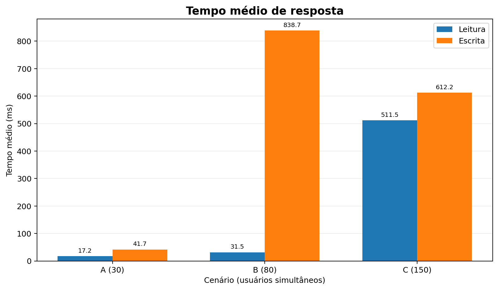
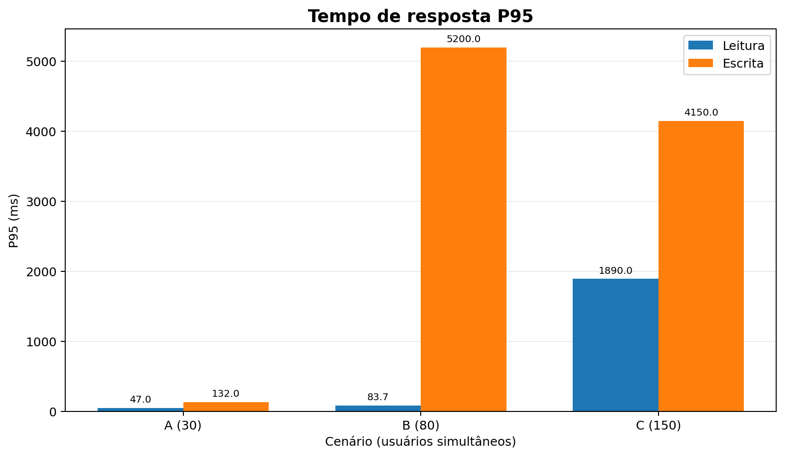
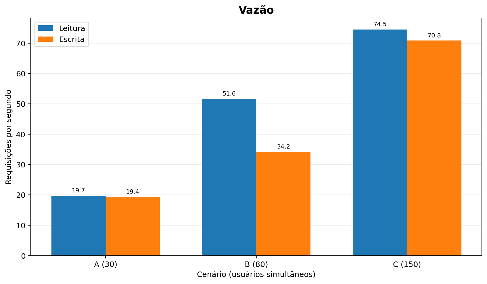
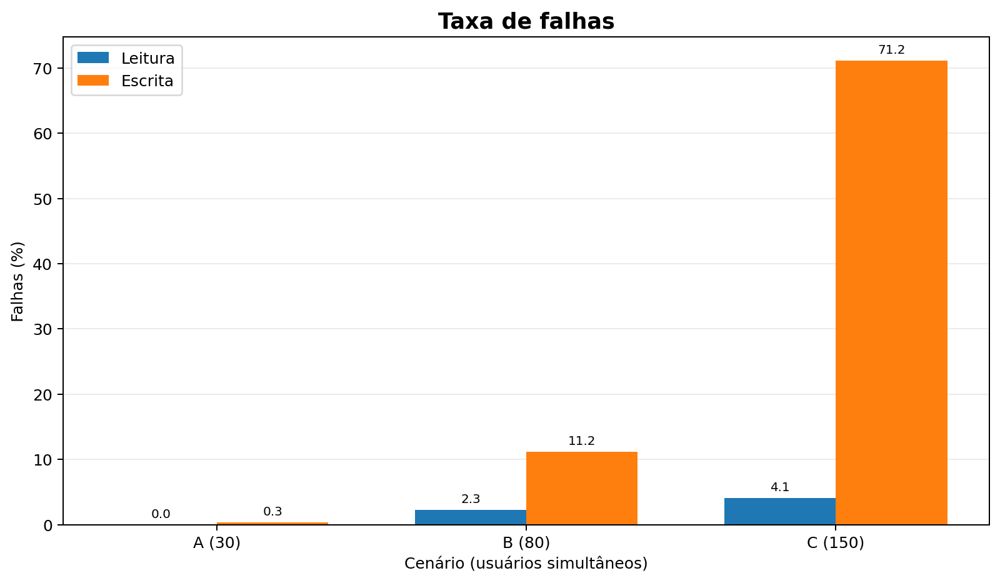
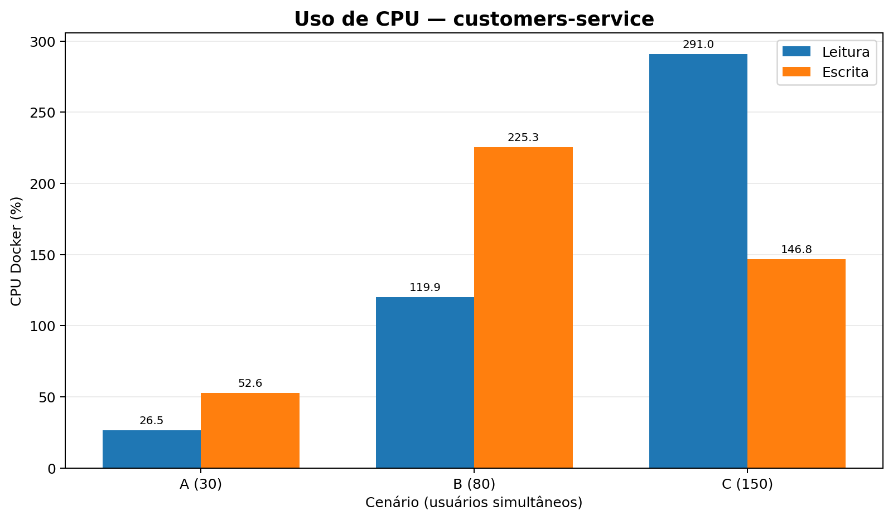
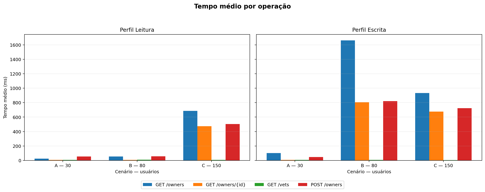
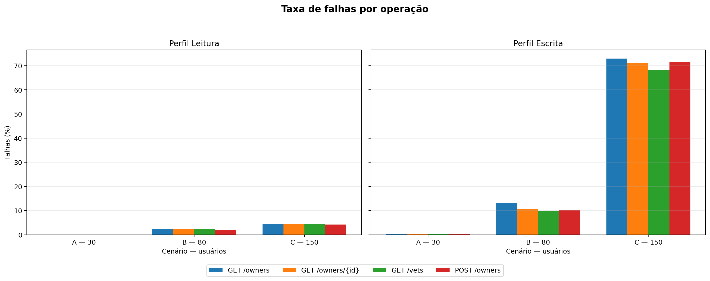

# Trabalho Prático 06 — Avaliação de Desempenho de Microsserviços com Locust

**Disciplina:** Sistemas Distribuídos  
**Aplicação:** [Spring PetClinic Microservices](https://github.com/spring-petclinic/spring-petclinic-microservices)  
**Tecnologias:** Docker Compose, Python, Locust e Docker Stats  
**Escopo:** 60 execuções experimentais distribuídas entre dois perfis de carga e três cenários, com resultados consolidados em tabelas e gráficos.

## 1. Objetivo

Avaliar o desempenho do Spring PetClinic Microservices sob dois perfis de utilização e três níveis de concorrência, utilizando o Locust como gerador de carga. O estudo compara tempo médio de resposta, percentil 95 (P95), vazão, total de requisições, percentual de falhas e utilização de CPU de microsserviços. Os resultados descrevem o comportamento observado no ambiente experimental local; não representam uma capacidade máxima universal da aplicação.

## 2. Ambiente experimental

| Componente | Configuração utilizada |
|---|---|
| Sistema operacional | Windows 11, 64 bits |
| Máquina | Aproximadamente 8 GB de RAM |
| Docker Desktop / Docker Engine | 4.50.0 / 28.5.1 |
| Docker Compose | v2.40.3 (`desktop-linux`) |
| Python | 3.12.6 |
| Locust | 2.46.7 |
| Matplotlib | 3.10.7 |
| Pandas | 3.0.6 |
| Git | 2.51.0.windows.1 |
| Java e Maven do host | OpenJDK 21 LTS e Maven 3.10.0 |
| Versão do PetClinic usada como referência | `1d76b00d683e86b62867a6bf59530f8ab301244f` |

A aplicação foi executada com **Docker Compose**. Para limitar o uso de recursos da máquina, foram inicializados apenas os seis serviços necessários:

| Serviço | Responsabilidade | Porta no host |
|---|---|---:|
| `config-server` | Configuração centralizada | 8888 |
| `discovery-server` | Descoberta e registro (Eureka) | 8761 |
| `customers-service` | Proprietários e animais | 8081 |
| `vets-service` | Veterinários | 8083 |
| `visits-service` | Visitas | 8082 |
| `api-gateway` | Entrada das requisições | 8080 |

O consumo de CPU foi acompanhado nos serviços `customers-service`, `vets-service` e `api-gateway`.

## 3. Preparação do ambiente e reprodução

### 3.1. Obter o código da aplicação

Na pasta principal do trabalho:

```powershell
git clone https://github.com/spring-petclinic/spring-petclinic-microservices.git
cd spring-petclinic-microservices
git checkout 1d76b00d683e86b62867a6bf59530f8ab301244f
```

### 3.2. Iniciar e conferir os microsserviços

Com o Docker Desktop iniciado, dentro da pasta do PetClinic:

```powershell
docker compose --parallel 1 pull config-server discovery-server customers-service vets-service visits-service api-gateway
docker compose up -d --no-build config-server discovery-server customers-service vets-service visits-service api-gateway
docker compose ps
docker stats --no-stream
```

A aplicação fica disponível em <http://localhost:8080> e o Eureka em <http://localhost:8761>. Os serviços precisam concluir sua inicialização e registro antes dos testes. Para encerrar após os procedimentos:

```powershell
docker compose stop
```

### 3.3. Endpoints efetivamente utilizados

As rotas solicitadas pelo professor foram verificadas na revisão do PetClinic adotada:

| Operação descrita no enunciado | Rota utilizada por meio do Gateway | Resposta HTTP esperada |
|---|---|---:|
| `GET /owners` | `GET /api/customer/owners` | 200 |
| `GET /owners/{id}` | `GET /api/customer/owners/1` (exemplo) | 200 |
| `GET /vets` | `GET /api/vet/vets` | 200 |
| `POST /owners` | `POST /api/customer/owners` | 201 |

Verificação das rotas de leitura:

```powershell
curl.exe -i http://localhost:8080/api/customer/owners
curl.exe -i http://localhost:8080/api/customer/owners/1
curl.exe -i http://localhost:8080/api/vet/vets
```

O cadastro utiliza JSON com `firstName`, `lastName`, `address`, `city` e `telephone`. Os cadastros do Locust recebem valores fictícios, com sobrenomes diferenciados por UUID. A operação POST foi validada inicialmente com HTTP 201.

### 3.4. Instalação do Locust e das bibliotecas para análise

Retorne à pasta principal `trabalho06-locust` e execute:

```powershell
python -m venv .venv
.\.venv\Scripts\Activate.ps1
python -m pip install -r requirements.txt
python -m pip install matplotlib==3.10.7 pandas==3.0.6
python -m py_compile .\locustfile.py
python -m locust --version
```

O projeto foi executado com Locust 2.46.7. Para visualizar os dois perfis pela interface do Locust:

```powershell
python -m locust -f .\locustfile.py --host http://localhost:8080 --class-picker
```

Interface: <http://localhost:8089>. Os perfis devem ser utilizados **separadamente** em cada configuração experimental.

## 4. Metodologia experimental

### 4.1. Perfis de utilização

| Operação | Perfil Leitura | Perfil Escrita |
|---|---:|---:|
| `GET /owners` | 45% | 20% |
| `GET /owners/{id}` | 35% | 20% |
| `GET /vets` | 15% | 20% |
| `POST /owners` | 5% | 40% |

O arquivo [`locustfile.py`](locustfile.py) implementa as classes `PerfilLeitura` e `PerfilEscrita`. As operações são escolhidas por tarefas ponderadas e o tempo de espera entre tarefas é `between(1, 2)` segundos. Consultas individuais selecionam IDs de 1 a 10; operações POST criam registros fictícios. Os pesos representam proporções esperadas, que podem variar entre execuções.

### 4.2. Cenários, aquecimento e repetições

| Cenário | Usuários simultâneos | Duração total | Aquecimento descartado | Repetições por perfil |
|---|---:|---|---|---:|
| A — Leve | 30 | 6 min | 1 min | 10 |
| B — Moderado | 80 | 6 min | 1 min | 10 |
| C — Elevado | 150 | 6 min | 1 min | 10 |

**Total: 2 perfis × 3 cenários × 10 repetições = 60 execuções.** A taxa de entrada foi de `--spawn-rate 10` usuários/s. O primeiro minuto foi descartado por reinicialização das estatísticas do Locust; as medições de CPU também foram filtradas para o período posterior ao aquecimento. Cada repetição produziu aproximadamente cinco minutos de dados efetivos de medição.

### 4.3. Controle inicial da base de dados

Antes de cada repetição **oficial**, o executor recriou o `customers-service`, aguardou uma resposta HTTP 200 com exatamente dez proprietários iniciais (IDs de 1 a 10) e aplicou uma espera adicional de 15 segundos. Esse foi o procedimento utilizado na coleta das **60 execuções originais**.

Após a coleta, um diagnóstico constatou respostas HTTP 405 transitórias após a recriação do serviço. A função de preparação foi então reforçada para exigir aproximadamente 30 segundos de respostas GET corretas consecutivas. A alteração é posterior às 60 execuções oficiais e foi empregada apenas nas verificações complementares.

Durante cada execução, as operações POST fazem a base crescer. Portanto, o volume retornado por `GET /owners` varia com o decorrer do teste; essa característica é discutida entre as limitações.

### 4.4. Execução automatizada, armazenamento e monitoramento

Na raiz do projeto, com Docker e Python preparados:

```powershell
python .\scripts\executar_experimentos.py --modo planejar
python .\scripts\executar_experimentos.py --modo lote --quantidade 10
```

O executor identifica as execuções concluídas, prepara a base de dados, executa o Locust em modo `headless`, acompanha CPU com `scripts/monitorar_cpu.py` e registra o andamento em `results/execucoes.csv`. Exemplo de comando para uma execução individual:

```powershell
python .\scripts\executar_experimentos.py --modo unico --perfil leitura --cenario C --repeticao 1
```

Na reprodução dos experimentos, os arquivos originais devem ser preservados para manter a rastreabilidade. O executor disponível neste repositório incorpora uma verificação de estabilidade posterior à coleta oficial, descrita na seção 4.3.

Consolidação estatística e geração dos gráficos:

```powershell
python .\scripts\analisar_resultados.py
python .\scripts\gerar_graficos.py
python .\scripts\analisar_operacoes.py
```

Os arquivos produzidos são organizados em `results/csv/` (estatísticas do Locust), `results/cpu/` (amostras de CPU), `results/tabelas/` (resumos), `results/graficos/` (visualizações) e `results/execucoes.csv` (registro de execução). Os dados auxiliares de diagnóstico foram mantidos separados das execuções oficiais.

### 4.5. Tratamento estatístico e interpretação

As tabelas apresentam **médias entre as dez repetições** de cada combinação de perfil e cenário. `requisicoes` representa o número médio de requisições por repetição **após o aquecimento**, não a soma das dez repetições. A coluna P95 do resumo é a **média dos P95 individuais**, não o P95 calculado a partir de todas as requisições agrupadas. Na análise por operação, a média do tempo de resposta foi ponderada pela quantidade de requisições registrada.

Os tempos e as vazões do Locust incluem observações de requisições que falharam; por isso, valores menores de latência ou maiores de vazão devem ser interpretados com a taxa de falhas correspondente. Nas médias de CPU do Docker, valores acima de 100% podem representar uso de múltiplos núcleos lógicos.

O indicador `Execucoes com problemas: 0` significa que as verificações de integridade implementadas no analisador foram satisfeitas, e não ausência de falhas HTTP. Foram preservados os valores produzidos pelos experimentos.

## 5. Resultados e análise

### 5.1. Execuções concluídas

Em 19/10/2026, o analisador reconheceu **60/60 execuções**, distribuídas conforme a matriz planejada:

| Perfil | A — 30 usuários | B — 80 usuários | C — 150 usuários |
|---|---:|---:|---:|
| Leitura | 10/10 | 10/10 | 10/10 |
| Escrita | 10/10 | 10/10 | 10/10 |

O analisador informou `Execucoes com problemas: 0`, dentro dos critérios de validação da coleta.

### 5.2. Comparação das métricas obrigatórias

**Tabela 1 — Médias das dez repetições por configuração, após o aquecimento.**

| Perfil | Cenário | Usuários | Requisições médias por repetição | Tempo médio (ms) | P95 médio (ms) | Vazão (req/s) | Falhas (%) |
|---|---|---:|---:|---:|---:|---:|---:|
| Leitura | A | 30 | 5.892,9 | 17,25 | 47,0 | 19,70 | 0,00 |
| Leitura | B | 80 | 15.435,4 | 31,53 | 83,7 | 51,60 | 2,30 |
| Leitura | C | 150 | 22.270,2 | 511,49 | 1.890 | 74,52 | 4,05 |
| Escrita | A | 30 | 5.795,9 | 41,74 | 132 | 19,36 | 0,31 |
| Escrita | B | 80 | 10.214,0 | 838,73 | 5.200 | 34,15 | 11,17 |
| Escrita | C | 150 | 21.176,9 | 612,23 | 4.150 | 70,82 | 71,17 |

**Tabela 2 — Utilização média de CPU (%), por microsserviço e configuração.**

| Perfil | Usuários | `customers-service` | `vets-service` | `api-gateway` |
|---|---:|---:|---:|---:|
| Leitura | 30 | 26,54 | 1,48 | 6,66 |
| Leitura | 80 | 119,90 | 3,37 | 18,87 |
| Leitura | 150 | 291,01 | 2,95 | 29,97 |
| Escrita | 30 | 52,59 | 1,22 | 6,91 |
| Escrita | 80 | 225,35 | 1,76 | 16,23 |
| Escrita | 150 | 146,77 | 1,18 | 16,11 |

Fonte de ambas as tabelas: [`results/tabelas/resumo_por_cenario.csv`](results/tabelas/resumo_por_cenario.csv). Os valores publicados estão arredondados para facilitar a leitura; o CSV mantém mais casas decimais.

### 5.3. Visualização dos resultados

As figuras sintetizam os indicadores centrais da avaliação. As versões individuais dos **11 gráficos** estão disponíveis em [`results/graficos/`](results/graficos/), juntamente com os CSVs que fundamentam as comparações. As médias e os percentis são calculados conforme a seção 4.5.

**Figura 1 — Tempo médio de resposta por perfil e cenário.**



**Figura 2 — Média dos percentis 95 por perfil e cenário.**



**Figura 3 — Vazão (requisições por segundo).**



**Figura 4 — Percentual de falhas.**



**Figura 5 — Utilização média de CPU do `customers-service`.**



**Figura 6 — Tempo médio por operação e configuração.**



**Figura 7 — Taxa de falhas por operação e configuração.**



Os gráficos complementares apresentam [total de requisições](results/graficos/05_total_requisicoes.png), [CPU do `vets-service`](results/graficos/07_cpu_vets.png), [CPU do `api-gateway`](results/graficos/08_cpu_gateway.png) e [P95 por operação](results/graficos/10_p95_por_operacao.png).

### 5.4. Degradação por operação

A comparação utiliza as quatro operações previstas no enunciado, em ambos os perfis e nos três cenários. Os **24 conjuntos de indicadores**, incluindo tempo médio, média dos P95 e taxa de falhas, constam de [`results/tabelas/resumo_por_operacao.csv`](results/tabelas/resumo_por_operacao.csv) e são representados nas Figuras 6 e 7 e no [gráfico de P95 por operação](results/graficos/10_p95_por_operacao.png).

A operação `GET /owners` apresentou os maiores tempos médios em condições de carga elevada: **685,82 ms** em Leitura C e **1.661,60 ms** em Escrita B. Neste último cenário, seu P95 médio atingiu **8.800 ms**. A criação de novos proprietários durante os testes ampliou o volume de dados potencialmente retornado nas consultas de listagem, mas não é possível isolar seu efeito das demais condições de concorrência.

Em Escrita C, `GET /owners` também apresentou a maior **taxa individual de falhas** (**72,91%**). Já `POST /owners`, que corresponde a 40% das tarefas desse perfil, registrou o maior **número absoluto de falhas** (**60.677**). O baixo tempo médio de `GET /vets` nos cenários de escrita não equivale a atendimento satisfatório: também houve respostas de erro nessa operação.

### 5.5. Respostas às cinco questões propostas

**1. Como o aumento de usuários afeta o tempo de resposta?**

O aumento de concorrência esteve associado à degradação da latência. No perfil Leitura, o tempo médio passou de 17,25 ms com 30 usuários para 31,53 ms com 80 usuários e 511,49 ms com 150 usuários. No perfil Escrita, o tempo médio passou de 41,74 ms (30) para 838,73 ms (80) e 612,23 ms (150). A queda de latência média no último cenário de Escrita **não deve ser interpretada automaticamente como melhoria**, pois 71,17% das requisições falharam; erros rápidos podem reduzir as médias agregadas. Os P95 confirmam a presença de respostas muito lentas, com 5.200 ms em Escrita B e 4.150 ms em Escrita C.

**2. Qual perfil apresenta maior vazão?**

O perfil **Leitura** apresentou maior vazão média nas três cargas: 19,70 contra 19,36 req/s em A; 51,60 contra 34,15 req/s em B; 74,52 contra 70,82 req/s em C. A vazão inclui falhas e, por esse motivo, deve ser acompanhada do percentual de requisições bem-sucedidas para avaliar a efetividade do atendimento.

**3. Quais operações apresentam maior degradação?**

`GET /owners` apresentou a maior degradação de tempo de resposta, sobretudo em **Escrita B**, com tempo médio de 1.661,60 ms e P95 médio de 8.800 ms. Outras operações relacionadas a proprietários também tiveram forte aumento de latência. Em **Escrita C**, a maior taxa individual de falhas foi de `GET /owners` (72,91%), enquanto `POST /owners` concentrou o maior número absoluto de falhas (60.677). Os resultados precisam ser lidos separando latência, proporção de erros e volume de requisições.

**4. Como o consumo de CPU varia entre os cenários?**

O `customers-service` concentrou o maior consumo observado. No perfil Leitura, sua média cresceu de **26,54%** (A) para **119,90%** (B) e **291,01%** (C). No perfil Escrita, cresceu de **52,59%** (A) para **225,35%** (B), mas ficou em **146,77%** em C. O `api-gateway` também utilizou mais CPU em cargas elevadas, enquanto `vets-service` apresentou médias baixas (cerca de 1% a 3,4%). A queda da CPU de Customers em Escrita C pode ser influenciada pela elevada proporção de falhas, mas os dados não permitem determinar uma causa única. Percentuais superiores a 100% são possíveis nas estatísticas do Docker devido à utilização de múltiplos núcleos.

**5. Qual cenário apresenta maior taxa de falhas?**

O cenário **Escrita C — 150 usuários** registrou a maior taxa média: **71,17%**, seguido por Escrita B (11,17%). Esse resultado representa forte degradação da disponibilidade no ambiente observado. Foram encontrados erros HTTP 405 nos GET e HTTP 503 no POST. Os códigos e a investigação posterior recomendam cautela antes de atribuir a causa exclusivamente à saturação por concorrência.

### 5.6. Detalhamento das falhas em Escrita C

**Tabela 4 — Totais acumulados das dez repetições oficiais de Escrita C.**

| Operação | Requisições | Falhas | Taxa individual de falhas |
|---|---:|---:|---:|
| `GET /owners` | 42.396 | 30.909 | 72,91% |
| `GET /owners/{id}` | 42.220 | 30.062 | 71,20% |
| `GET /vets` | 42.426 | 29.019 | 68,40% |
| `POST /owners` | 84.727 | 60.677 | 71,61% |
| **Total** | **211.769** | **150.667** | **71,15%** |

O total ponderado **71,15%** resulta de 150.667 falhas divididas por 211.769 requisições. O valor **71,17%** da Tabela 1 é a média aritmética das taxas das dez execuções; a diferença é decorrente da forma de agregação.

### 5.7. Limitações e verificações complementares

As execuções oficiais registraram respostas **HTTP 405** nas operações GET e **HTTP 503** em operações POST, especialmente sob alta carga. O HTTP 405 indica método não permitido, enquanto o HTTP 503 corresponde à indisponibilidade do serviço. Esses códigos não permitem concluir, isoladamente, que a causa foi saturação de CPU.

Após os 60 experimentos, verificações complementares identificaram respostas HTTP 405 transitórias durante a estabilização posterior à recriação do `customers-service`. Mesmo com um procedimento posterior que exigia 30 segundos de estabilidade nas rotas GET, um ensaio diagnóstico separado com 150 usuários registrou **17.006 falhas em 25.144 requisições (67,63%)**. Logs do Gateway também registraram indisponibilidade temporária de instâncias do serviço de clientes. Os diagnósticos não substituíram nem alteraram as 60 execuções oficiais.

Há três limitações relevantes na interpretação dos resultados: a preparação inicial das execuções oficiais não exigia estabilidade contínua de todas as rotas; o conjunto de proprietários crescia durante cada execução por efeito dos cadastros; e as estatísticas de tempo de resposta e vazão incluem requisições malsucedidas. Consequentemente, os resultados caracterizam o comportamento **na infraestrutura e nas condições avaliadas**, sem estabelecer causalidade exclusiva entre número de usuários e falhas HTTP.

### 5.8. Conclusões

As 60 execuções permitiram comparar os perfis de Leitura e Escrita nas cargas de 30, 80 e 150 usuários. O perfil Leitura manteve maior vazão média nas três situações, enquanto o perfil Escrita apresentou degradação mais severa, especialmente com 150 usuários, quando a taxa média de falhas chegou a 71,17%.

O `customers-service` foi o componente com maior utilização média de CPU, e `GET /owners` apresentou os maiores tempos de resposta entre as operações analisadas sob carga elevada. A análise também evidenciou que vazão e latência, isoladamente, são insuficientes para avaliar a qualidade do atendimento: é necessário considerar as falhas e a natureza das respostas.

Os testes demonstraram a importância de controlar o estado da base e verificar a estabilidade dos microsserviços em avaliações distribuídas. Os resultados contribuem para identificar pontos de atenção no PetClinic executado localmente, mas sua generalização depende de novas medições em ambientes mais controlados e com observabilidade adicional.

## 6. Organização dos arquivos

```text
trabalho06-locust/
├── README.md
├── locustfile.py
├── requirements.txt
├── scripts/
│   ├── executar_experimentos.py
│   ├── monitorar_cpu.py
│   ├── analisar_resultados.py
│   ├── gerar_graficos.py
│   └── analisar_operacoes.py
├── results/
│   ├── csv/                  # Estatísticas originais do Locust
│   ├── cpu/                  # Medições de CPU
│   ├── tabelas/              # Consolidações das 60 execuções
│   ├── graficos/             # 11 gráficos produzidos na análise
│   └── execucoes.csv         # Controle dos experimentos
└── evidencias/               # Capturas de tela da execução
```

Os **CSVs e gráficos** permanecem em `results/`, como previsto no enunciado. A pasta `evidencias/` reúne capturas de tela da aplicação e da execução do experimento, utilizadas como documentação complementar. Os gráficos não foram duplicados nessa pasta, evitando redundância de arquivos. O código-fonte do PetClinic é obtido pelo repositório e pela revisão indicada na seção 2.

## 7. Referências

- [Spring PetClinic Microservices — repositório oficial](https://github.com/spring-petclinic/spring-petclinic-microservices).
- Enunciado da disciplina: *Trabalho Prático 06 — Avaliação de Desempenho de Microsserviços com Locust*.
